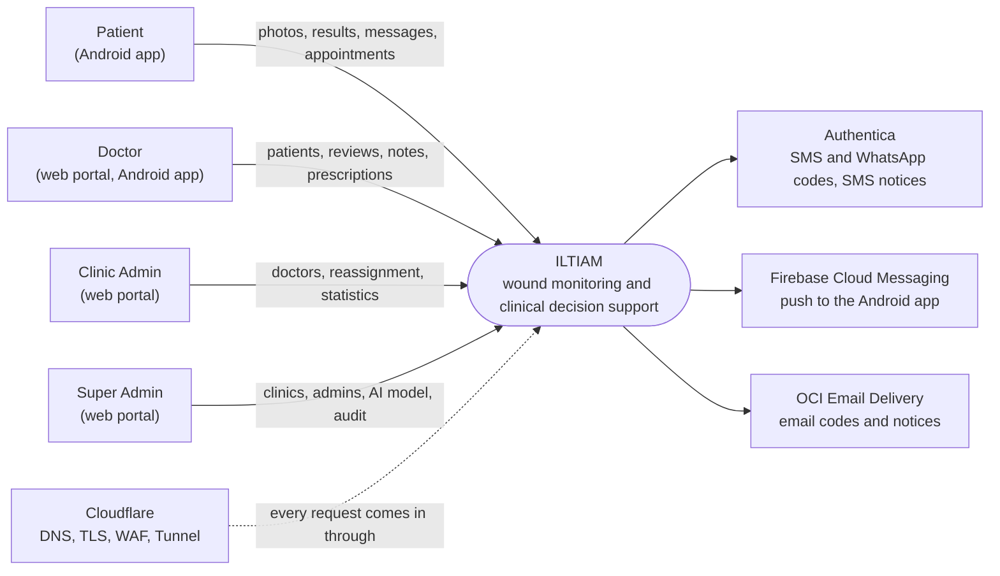
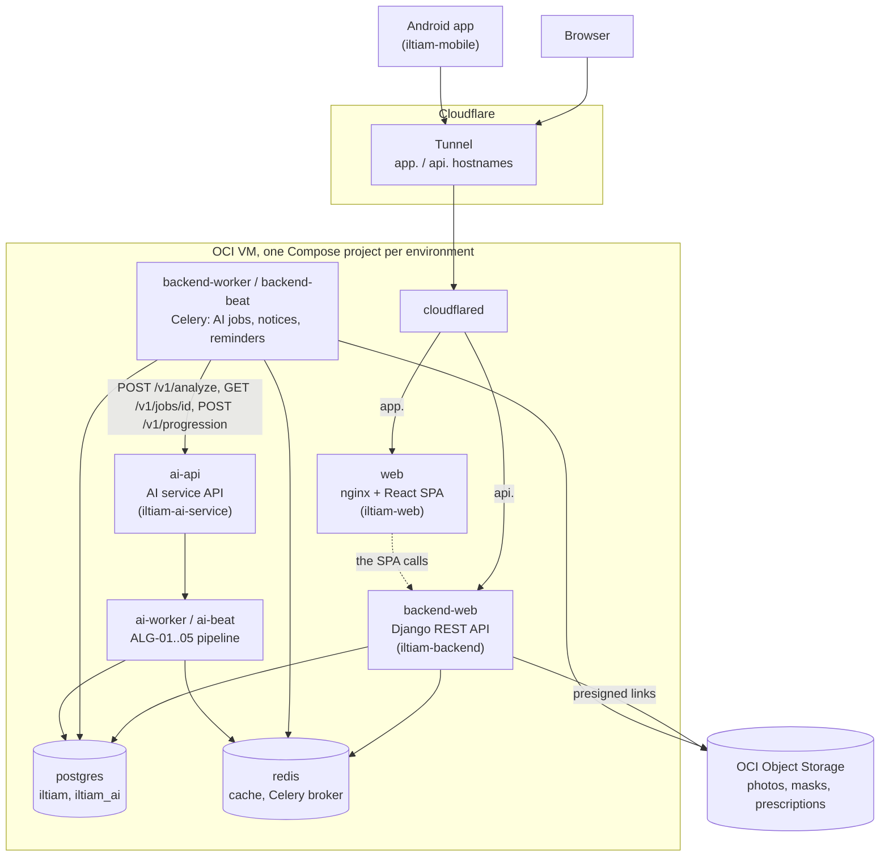

# System architecture (C4)

ILTIAM as built: what talks to what, and where it runs. Written from the code and the Compose stack, not from the
SRS diagrams (the differences are in [SRS divergences](srs-divergences.md)). The flows between the parts are in the
[integration guide](integration.md).

## Level 1: system context

- **Patients** use the Android app only (iOS is v1.1, [SD-11](srs-divergences.md)).
- **Doctors** use the web portal and the same app ([SD-04](srs-divergences.md)).
- **Admins** use the web portal only; the backend refuses them in the app (`WEB_PORTAL_ONLY`, iltiam-backend#106).

## Level 2: containers

One Oracle Cloud ARM VM in Riyadh runs staging and production as two Compose projects
([ADR-0004](adr/0004-hosting.md), [Runbook 5](runbooks/05-compose-stack.md), [`compose.yml`](https://github.com/iltiam/iltiam-deployment/blob/main/compose.yml)).
Each project has the containers below.

- **Only `web` and `backend-web` are reachable from the internet**, through the tunnel; the AI service is never
  routed ([Runbook 3](runbooks/03-cloudflare-tunnels.md)). No container publishes a port.
- **Files** live in OCI Object Storage (private, encrypted buckets); clients get presigned links of at most
  15 minutes.
- **The AI service** has its own database (`iltiam_ai`) and queue; the backend reaches it with a service token.

## Level 3: the backend's modules

The backend is a modular monolith ([iltiam-backend](https://github.com/iltiam/iltiam-backend)):

| App | Holds |
|---|---|
| `accounts` | users, two-step sign-in, sessions, step-up, Super Admin invitations |
| `clinics` | clinics, doctors, reassignment, clinic event log |
| `patients` | patients, consents, data export and deletion, doctor dashboard |
| `wounds` | wounds, visits, uploads, the AI job and progression |
| `analysis` | doctor reviews, alerts, the corrections dataset |
| `clinical` | SOAP notes, prescriptions, care plans |
| `appointments`, `messaging` | appointments and next-visit reminders; patient–doctor messages |
| `notifications` | the notification catalogue, push, SMS, email, reminders, breach notices |
| `reports` | statistics and PDF reports |
| `storage`, `integrations.ai` | object storage; the AI service client and its vendored contract |
| `core` | audit log, errors, rate limits, retention |
