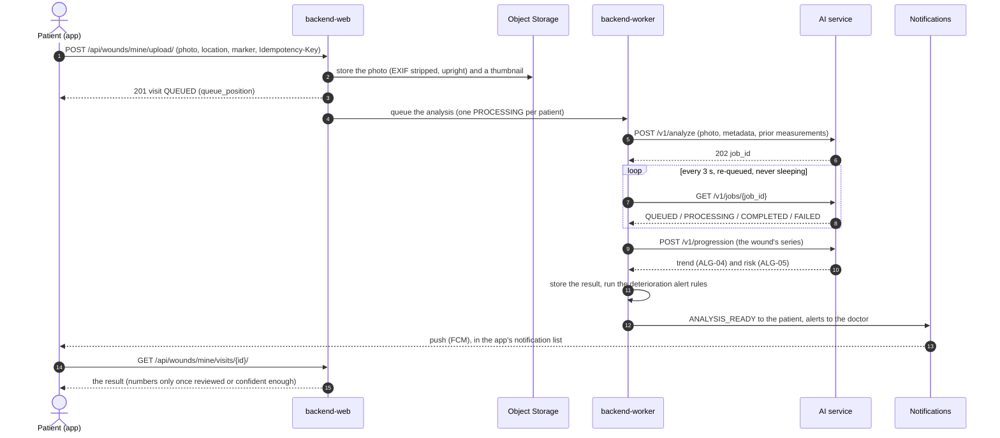
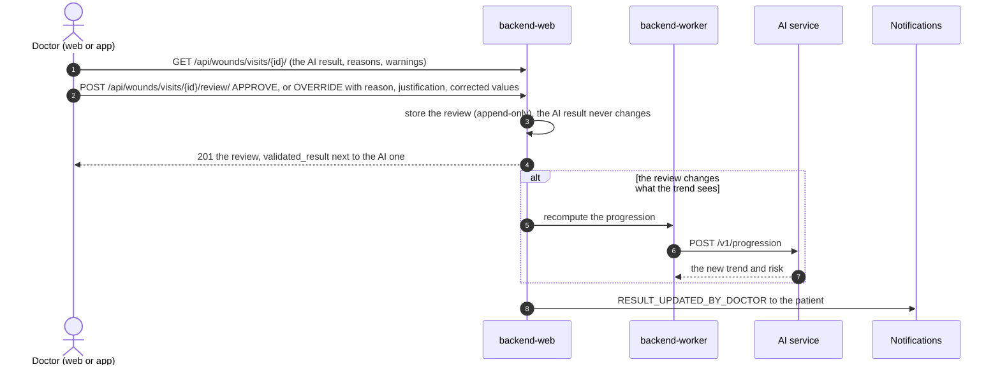

# Integration guide

How the parts talk to each other, with the calls each one makes. The contracts are the source of truth:

- **Apps ↔ backend:** iltiam-backend `docs/api/openapi.json` (released as `api-vX.Y.Z`), and the topic pages in
  `docs/api/` (auth, wounds, review, notifications, ...).
- **Backend ↔ AI service:** iltiam-ai-service `docs/api/schemas/` and `docs/api/contracts.md` (released as
  `contract-vX.Y.Z`; the backend vendors one release in `apps/integrations/ai/contract/`).

The containers are in [System architecture](architecture.md).

## Apps ↔ backend

- **Sign-in:** two steps. `POST /api/auth/login/` with phone and password answers a challenge and sends a code;
  `POST /api/auth/login/verify/` with the code answers the JWTs. The access token lasts 15 minutes and the session
  ends after 15 minutes without a request; the client refreshes once with `POST /api/auth/token/refresh/`.
- **Every answer** that is an error uses one envelope, `{"error": {"code", "message", "action"}}`, with the message
  and action already in the user's language (`Accept-Language`).
- **Generated clients:** the web app (`web/src/api/`) and the mobile app (`lib/data/api/`) generate their types from
  the backend contract; neither hand-writes requests.

## Upload → analysis → result

- **Retries:** the AI client never sleeps: a `429` waits `Retry-After`; three attempts in all, then the visit is
  FAILED, audited, and the doctor is told (`ANALYSIS_FAILED`); only the doctor's retry starts it again.
- **What patients see:** numbers only when a doctor reviewed the result, or the AI accepted it with enough
  confidence; "no wound found" asks for a new photo and tells the patient the doctor will look
  ([SD-05](srs-divergences.md)).

## Doctor review

## Notifications

- **One way in:** `notify(user, kind, ...)` stores the in-app notification, then delivers it on the channels its
  type has in the catalogue (`apps/notifications/catalog.py`), unless the user switched that type off (safety
  notices can't be).
- **Push:** Firebase Cloud Messaging to the Android app's registered devices; dead tokens are revoked.
- **SMS and codes:** Authentica ([SD-09](srs-divergences.md)); a code
  that can't be sent by SMS can go by WhatsApp or email. On staging, nothing is sent to the reserved
  `+96659999xxxx` test numbers.
- **Email:** OCI Email Delivery, bilingual text and HTML.
- **Timed notices** (reminders, deadlines) are idempotent rules run by `backend-beat`.
