# ILTIAM v1.0 plan: ordered work per person

**Goal:** everything done before **2026-12-01**.
- Milestone **v1.0** (due 2026-11-30) holds every issue, except the iOS / App Store work.
- Milestone **v1.1** holds the iOS / App Store work: MOB-34, MOB-35, MOB-36.
- Nothing is dropped: P2 items are in v1.0 too and come last in each list.

**How to work:**
- Each person takes their list **top to bottom**.
- "Waits for" names another person's issue. If it isn't merged yet, take the next issue whose blockers are done, and say so in the team chat.
- Every PR is reviewed by the repo owner:
  - ai-service and deployment: ben-fatah;
  - backend: Omar-Nasri;
  - web: Mn9p and aalbabtain review each other;
  - mobile: MYF25.

**Ordering rule** (generated by `tools/generate.py`):
1. Dependencies first (an issue never comes before its blockers).
2. Then v1.0 before v1.1.
3. Then issues already in progress.
4. Then priority.
5. Then the natural sequence.

**Priority rule:**
- **P0** = blocks another P0/P1 issue (computed across all repos) or is part of the end-to-end flow.
- **P1** = the rest of v1.0.
- **P2** = do last.

**Release gates:** a few issues carry "Do after" gates. These order the work without changing anyone's priority.
- MOB-27 device tests: after the other mobile P0/P1 work.
- WEB-32 Playwright suite: after the web P0/P1 pages.
- DEP-08 load test: after the backend P0/P1 API.
- DEP-11 go-live: after every other P0/P1 v1.0 issue.

**Size:** S ≈ 1 day, M ≈ 2, L ≈ 3. Nothing is bigger.

**Ahmed helps Mohammad in Flutter.** He builds the mobile screens for features he already built on the web:
- MOB-20 (doctor messaging) and MOB-21 (patient messaging), after WEB-19;
- MOB-31 (SOAP notes), MOB-32 (prescriptions and next visit) and MOB-33 (care plan editor and appointment handling).

Mohammad reviews these.

**Two things with a fixed clock:**
1. **MOB-28a, the Google Play closed test.** A personal Play developer account needs 12 testers opted in for 14 continuous days before production access ([Play Console Help](https://support.google.com/googleplay/android-developer/answer/14151465?hl=en)). Start it by **15 Nov** at the latest. It is #6 in Mohammad's list for that reason.
2. **DEP-14, the Authentica sender name.** Approval has a lead time. ben-fatah requests it at the very start.

## Team rules (every issue, every repo)

- **One contract:** the backend OpenAPI (BE-01) is the only API source. Web (WEB-02) and mobile (MOB-01) generate their clients from it. A breaking change needs the `breaking-api` label and a heads-up.
- **Auth and RBAC:** every new endpoint goes into `tests/test_rbac_matrix.py` and `docs/api/rbac.md`. Clients hide what a role can't do, but the backend decides.
- **i18n:** Arabic and English for every user-facing string, RTL checked. Show the backend's bilingual error messages; don't rewrite them.
- **PDPL:**
  - no health data in logs, push payloads, crash reports or third parties;
  - processors and retention follow DEP#6;
  - breach handling follows DEP-09 and BE-17;
  - patients never see raw model output.
- **Security:**
  - secrets only in GitHub Environments (DEP#3), never in git;
  - backend rate limits stay;
  - Cloudflare edge rules (DEP#9) and scans in CI (DEP-07).
- **Observability:** JSON logs carry the request id across backend and AI (BE-03, AI-04); metrics go to DEP#10.
- **Tests:** each issue lists its tests. End-to-end coverage: DEP-10 (smoke after every staging deploy), WEB-32 (Playwright), MOB-27 (Android devices).
- **Release:** merge to `main` deploys to staging (DEP-03). Production deploys only from approved release tags (DEP-04). Android goes to Google Play (MOB-28a, MOB-28).
- **Never** open held-out test splits or use `--heldout`. AI-03 and AI-09 use training and validation images only.

## Per-person ordered lists

### Thabit (@ben-fatah): 28 issues · P0 21 · P1 5 · P2 2

| # | Plan ID | Repo | Title | Pri | Size | Milestone | Waits for (other people) |
|---|---|---|---|---|---|---|---|
| 1 | DEP#7 | deployment | Runbook 1: Oracle Always Free account (Riyadh), $10 budget alert, one Ampere A1 VM with Docker | P0 | M | v1.0 | — |
| 2 | AI-12 | ai-service | ARM go/no-go: measure the analysis latency on the Ampere A1 VM against the 4 s budget | P0 | S | v1.0 | — |
| 3 | DEP#1 | deployment | Reusable GitHub Actions workflows (python-ci, node-ci, flutter-ci, multi-arch docker build+push to GHCR) | P0 | M | v1.0 | — |
| 4 | DEP#3 | deployment | Runbook 4: secrets and environment files (GitHub Environments, rotation, third-party keys) | P0 | M | v1.0 | — |
| 5 | DEP-01 | deployment | Runbook 2: Cloudflare account, DNS for <DOMAIN>, SSL/TLS and email records | P0 | S | v1.0 | — |
| 6 | AI-07 | ai-service | Production image (linux/arm64) and weights delivery for staging and production | P0 | M | v1.0 | — |
| 7 | AI-10 | ai-service | Contract release process: versioned schemas/OpenAPI artifacts and a vendoring script | P0 | S | v1.0 | — |
| 8 | DEP#9 | deployment | Runbook 3: Cloudflare Tunnels for staging and production, cache and security rules (no public web ports) | P0 | M | v1.0 | — |
| 9 | DEP-02 | deployment | Runbook 8: object storage within the free 20 GB, software Vault keys, S3 credentials | P0 | M | v1.0 | — |
| 10 | DEP-13 | deployment | Runbook 11: Firebase project for FCM push on Android (service account and app configs) | P0 | S | v1.0 | — |
| 11 | DEP-14 | deployment | Runbook 12: Authentica account, sender name and API key for phone codes | P0 | S | v1.0 | — |
| 12 | AI-01 | ai-service | /capabilities: registry metrics, release date and registry name of the loaded model | P0 | S | v1.0 | — |
| 13 | DEP#2 | deployment | Runbook 5: staging and production as two Compose projects on one ARM VM (memory budget, private AI) | P0 | L | v1.0 | BE-04 (Omar), BE-02 (Omar), WEB-03 (Ahmed) |
| 14 | AI-02 | ai-service | Per-request manual-review threshold for FR-D-5 governance | P0 | S | v1.0 | — |
| 15 | AI-04 | ai-service | Observability: Prometheus /metrics, JSON logs, job timing histograms | P0 | M | v1.0 | — |
| 16 | DEP-03 | deployment | Runbook 9: continuous deployment to the staging project on merge to main | P0 | M | v1.0 | — |
| 17 | AI-03 | ai-service | Threshold re-evaluation report from stored validation predictions | P0 | M | v1.0 | — |
| 18 | DEP#6 | deployment | PDPL mapping, ROPA, retention schedule, consent texts and user agreement | P0 | M | v1.0 | — |
| 19 | DEP#8 | deployment | Runbook 6: free backups and a weekly tested restore on the VM (Postgres dumps, volume backups) | P0 | M | v1.0 | — |
| 20 | DEP-04 | deployment | Runbook 10: production project on the same VM, release with approval, rollback, and when to split | P0 | M | v1.0 | — |
| 21 | AI-09 | ai-service | Field photo set: printed dataset wounds with the 50 mm marker photographed by phones | P1 | S | v1.0 | — |
| 22 | DEP#10 | deployment | Runbook 7: lightweight monitoring, logs, alerts and uptime (fits the free VM) | P1 | L | v1.0 | BE-27 (Ahmed) |
| 23 | DEP#5 | deployment | Local full-stack development environment (one command, seed, reset) | P1 | M | v1.0 | — |
| 24 | DEP-09 | deployment | Threat model, incident response and 72-hour breach notification runbook | P1 | M | v1.0 | — |
| 25 | AI-05 | ai-service | Model update without downtime (NFR-MAI-01) | P1 | M | v1.0 | — |
| 26 | DEP-11 | deployment | Go-live checklist and production launch | P0 | S | v1.0 | DEP-08 (Mansour), MOB-28 (Mohammad), WEB-32 (Mansour) |
| 27 | AI-06 | ai-service | Drift monitoring from production aggregates (SRS 5.6.3) | P2 | M | v1.0 | — |
| 28 | DEP#4 | deployment | System documentation: C4 context/container, integration guide, cross-repo ADR index | P2 | M | v1.0 | — |

### Omar (@Omar-Nasri): 29 issues · P0 25 · P1 3 · P2 1

| # | Plan ID | Repo | Title | Pri | Size | Milestone | Waits for (other people) |
|---|---|---|---|---|---|---|---|
| 1 | BE#55 | backend | Send each analysis's ALG-02 version to the AI service as segmentation_version | P0 | S | v1.0 | — |
| 2 | BE#57 | backend | Keep model_checksums and runtime_versions from failed AI jobs | P0 | S | v1.0 | — |
| 3 | BE#56 | backend | UC-SA-03 E3: a missed ALG-03 target must disable ALG-03, not block submissions | P1 | S | v1.0 | — |
| 4 | BE-01 | backend | OpenAPI as the single API contract: versioning, breaking-change check, published artifact | P0 | M | v1.0 | — |
| 5 | BE-02 | backend | Health and readiness endpoints | P0 | S | v1.0 | — |
| 6 | BE-04 | backend | Backend Dockerfile (web, worker, beat) and production entrypoint | P0 | M | v1.0 | DEP#1 (Thabit) |
| 7 | BE-03 | backend | Production settings hardening, security headers, structured logs, request-id propagation | P0 | M | v1.0 | — |
| 8 | BE-05 | backend | File URLs reachable by web and mobile (public storage endpoint, absolute media URLs) | P0 | S | v1.0 | — |
| 9 | BE-31 | backend | Production bootstrap and staging test accounts | P0 | S | v1.0 | — |
| 10 | BE-32 | backend | Sync vendored AI contract to the released version and use realistic fixtures | P0 | S | v1.0 | AI-10 (Thabit) |
| 11 | BE-06 | backend | Doctor visit detail: photo and mask URLs, measurement and applied threshold | P0 | M | v1.0 | — |
| 12 | BE-07 | backend | List a wound's visits for doctor and patient (submission history and image timeline) | P0 | M | v1.0 | — |
| 13 | BE-39 | backend | Patient result: "wound not found" asks for a retake and says the doctor will review | P0 | S | v1.0 | — |
| 14 | BE-08 | backend | Wound images: strip EXIF (GPS) and normalise orientation on upload | P0 | S | v1.0 | — |
| 15 | BE-09 | backend | Dev/staging command: seed a real dated analysis series through the AI pipeline | P0 | M | v1.0 | — |
| 16 | BE-12 | backend | Step-up verification (re-enter OTP) for sensitive actions | P0 | M | v1.0 | — |
| 17 | BE-19 | backend | Push notifications in production: FCM (Android), device lifecycle, test push | P0 | S | v1.0 | DEP#3 (Thabit), DEP-13 (Thabit) |
| 18 | BE-20 | backend | Phone codes through Authentica, email provider, and the OTP fallback prompt | P0 | M | v1.0 | DEP#3 (Thabit), DEP-01 (Thabit), DEP-14 (Thabit) |
| 19 | BE-37 | backend | Doctor dashboard summary endpoint (risk-ranked worklist) | P0 | M | v1.0 | — |
| 20 | BE-11a | backend | FR-D-5: Super Admin changes the manual-review threshold (OTP, 40 % floor, audit, applied to analyses) | P0 | M | v1.0 | AI-02 (Thabit) |
| 21 | BE-13 | backend | Patient data export as background jobs (JSON/PDF) with status and download | P0 | M | v1.0 | — |
| 22 | BE-21 | backend | Production object storage wiring and key rotation support | P0 | S | v1.0 | DEP-02 (Thabit) |
| 23 | BE-11b | backend | Threshold change: doctor notification and re-evaluation report | P0 | M | v1.0 | AI-03 (Thabit) |
| 24 | BE-14 | backend | Patient can cancel a pending deletion request | P0 | S | v1.0 | — |
| 25 | BE-15 | backend | Prescriptions: COMPLETED status, detail fields and refill requests | P0 | M | v1.0 | — |
| 26 | BE-10 | backend | AI model panel: join on checksum/registry_name and show metrics, threshold, tissue status | P0 | S | v1.0 | AI-01 (Thabit) |
| 27 | DEP-12 | deployment | System-level SRS divergence register (decisions that differ from the SRS PDF) | P1 | S | v1.0 | — |
| 28 | BE-34 | backend | Idempotency-Key on uploads (offline retries never double-submit) | P1 | S | v1.0 | — |
| 29 | BE-18 | backend | Bilingual clinician texts for AI decision reasons and warnings | P2 | S | v1.0 | — |

### Mohammad (@MYF25): 32 issues · P0 21 · P1 10 · P2 1 · 3 in v1.1

| # | Plan ID | Repo | Title | Pri | Size | Milestone | Waits for (other people) |
|---|---|---|---|---|---|---|---|
| 1 | MOB-01 | mobile | Generated API client from the backend OpenAPI; replace guessed Dio paths | P0 | M | v1.0 | BE-01 (Omar) |
| 2 | MOB-02 | mobile | Build flavors and platform config: dev/staging/prod, network security, no mock in production | P0 | S | v1.0 | — |
| 3 | MOB-03 | mobile | Internal distribution: CI builds staging Android builds and ships them to testers | P0 | M | v1.0 | — |
| 4 | MOB-04 | mobile | Sign-in on the real backend: phone + password + OTP (SMS/email/authenticator), tokens, refresh, role routing | P0 | M | v1.0 | BE-31 (Omar) |
| 5 | MOB-05 | mobile | Sign-in security: CAPTCHA after 3 failures, remember device 30 days, biometric unlock, 15-min timeout | P0 | M | v1.0 | — |
| 6 | MOB-28a | mobile | Google Play Console: app, Play App Signing, internal testing, and a 14-day closed test with 12 testers | P0 | M | v1.0 | — |
| 7 | MOB-07 | mobile | Patient photo upload on the real backend (fields, duplicate 409, idempotency, offline queue) | P0 | M | v1.0 | — |
| 8 | MOB-08 | mobile | Patient result screen on the real backend (5 states, tips, overlay, disclaimer) | P0 | M | v1.0 | BE-39 (Omar) |
| 9 | MOB-09 | mobile | Patient wounds list and submission history (filters, thumbnails, AI summary) | P0 | M | v1.0 | BE-07 (Omar) |
| 10 | MOB-11 | mobile | Push notifications with FCM on Android (setup and device registration) | P0 | M | v1.0 | BE-19 (Omar), DEP-13 (Thabit) |
| 11 | MOB-12 | mobile | Doctor: patient list, search/filters, profile and register new patient | P0 | M | v1.0 | — |
| 12 | MOB-13 | mobile | Doctor: capture/upload for a patient and analysis status (6 statuses, 10 reasons) | P0 | M | v1.0 | BE-06 (Omar) |
| 13 | MOB-15 | mobile | Doctor: AI result view (overlay toggle, area ± uncertainty, dimensions, confidence, risk factors, versions) | P0 | M | v1.0 | BE-06 (Omar) |
| 14 | MOB-16 | mobile | Doctor: review (approve / override with justification) and side-by-side | P0 | M | v1.0 | — |
| 15 | MOB-24 | mobile | Deep links, in-app notification centre and read state | P0 | M | v1.0 | — |
| 16 | MOB-18 | mobile | Doctor: dashboard and worklist (needs review, failed with retry) | P0 | M | v1.0 | BE-37 (Omar) |
| 17 | MOB-19 | mobile | Doctor: wound progression timeline and deterioration alerts | P0 | M | v1.0 | — |
| 18 | MOB-06 | mobile | Password reset and change on the real backend | P1 | S | v1.0 | — |
| 19 | MOB-10 | mobile | Patient progression chart with the five ALG-04 statuses | P1 | S | v1.0 | BE-09 (Omar) |
| 20 | MOB-14 | mobile | Patient appointments on the backend (request, cancel, history, reminders) | P1 | S | v1.0 | — |
| 21 | MOB-17 | mobile | Patient care plan on the backend (versions, acknowledgement) | P1 | S | v1.0 | — |
| 22 | MOB-25 | mobile | Patient privacy on the backend: consents, export jobs, access log, deletion request and cancel, step-up | P1 | M | v1.0 | BE-12 (Omar), BE-13 (Omar), BE-14 (Omar) |
| 23 | MOB-26 | mobile | Offline read-only access to recent history and results (FR-P-7.2) | P1 | M | v1.0 | — |
| 24 | MOB-22 | mobile | Patient prescriptions: list, detail, PDF download, expiry, refill request | P1 | M | v1.0 | BE-15 (Omar) |
| 25 | MOB-23 | mobile | Patient profile and preferences (medical background, photo, language, notification preferences) | P1 | S | v1.0 | — |
| 26 | MOB-29 | mobile | Arabic/RTL, accessibility and plain-language audit of all new screens | P1 | S | v1.0 | — |
| 27 | MOB-27 | mobile | Integration tests against staging on an Android device matrix | P0 | M | v1.0 | — |
| 28 | MOB-28 | mobile | Google Play production release: listing AR/EN, data safety, review, rollout | P0 | M | v1.0 | DEP#6 (Thabit) |
| 29 | MOB-30 | mobile | Crash and error reporting (privacy-safe) | P2 | S | v1.0 | — |
| 30 | MOB-34 | mobile | iOS builds: signing, flavors and TestFlight | P0 | M | v1.1 | — |
| 31 | MOB-35 | mobile | iOS push notifications: APNs key in Firebase, capabilities, permission flow | P0 | S | v1.1 | — |
| 32 | MOB-36 | mobile | App Store release: listing, privacy nutrition labels, review, iOS device tests | P1 | M | v1.1 | — |

### Mansour (@Mn9p): 23 issues · P0 12 · P1 9 · P2 2

| # | Plan ID | Repo | Title | Pri | Size | Milestone | Waits for (other people) |
|---|---|---|---|---|---|---|---|
| 1 | WEB-06 | web | Doctor: patient list (search, filters, risk colours) and register patient on the API | P0 | M | v1.0 | WEB-02 (Ahmed) |
| 2 | WEB-08 | web | Doctor: wound photo upload on the API (8 MP, 50 mm marker, duplicate confirm, queue position) | P0 | M | v1.0 | WEB-02 (Ahmed) |
| 3 | WEB-11 | web | Doctor: analyses needing attention, retry, and failure notifications | P0 | S | v1.0 | WEB-02 (Ahmed) |
| 4 | WEB-13 | web | Doctor: alerts panel, acknowledge with justification, risk-ranked dashboard | P0 | M | v1.0 | WEB-02 (Ahmed) |
| 5 | WEB-07 | web | Doctor: patient profile with wounds and image timeline | P0 | M | v1.0 | BE-07 (Omar) |
| 6 | BE-26 | backend | Clinic-scoped account event log for Clinic Admins | P0 | S | v1.0 | — |
| 7 | WEB-10 | web | Doctor: review (approve / override with justification), side-by-side, feedback consent | P0 | M | v1.0 | WEB-09 (Ahmed) |
| 8 | DEP-10 | deployment | Cross-repo end-to-end smoke after every staging deploy | P0 | M | v1.0 | DEP-03 (Thabit) |
| 9 | WEB-20 | web | Clinic Admin: doctors list, add doctor, deactivate on the API | P0 | M | v1.0 | WEB-04 (Ahmed) |
| 10 | WEB-21 | web | Clinic Admin: reassign patients (single, bulk, unassigned) | P0 | S | v1.0 | — |
| 11 | WEB-15 | web | Doctor: SOAP clinical notes on the API | P1 | M | v1.0 | — |
| 12 | WEB-18 | web | Doctor: appointments and next-visit reminders on the API | P1 | M | v1.0 | — |
| 13 | WEB-17 | web | Doctor: care plan editor and shared notes control | P1 | M | v1.0 | — |
| 14 | WEB-22 | web | Clinic Admin: statistics with PDF export and account events log | P1 | M | v1.0 | — |
| 15 | BE-22 | backend | Retention jobs from the PDPL retention schedule | P1 | M | v1.0 | DEP#6 (Thabit) |
| 16 | BE-24 | backend | Security fixes from scans and review (ZAP, dependency audit) | P1 | S | v1.0 | DEP-07 (Ahmed) |
| 17 | DEP-08 | deployment | Load and performance tests (NFR-PERF, NFR-SCA) without hurting production on the shared VM | P0 | M | v1.0 | DEP-03 (Thabit) |
| 18 | BE-23 | backend | Performance fixes from the staging load test | P1 | M | v1.0 | — |
| 19 | WEB-31 | web | Arabic/RTL, accessibility and plain-language audit (all pages) | P1 | M | v1.0 | — |
| 20 | WEB-32 | web | Playwright E2E suite against staging (all actors) | P0 | M | v1.0 | WEB-23 (Ahmed) |
| 21 | WEB-34 | web | Cross-browser verification (latest two Chrome, Firefox, Safari) | P1 | S | v1.0 | — |
| 22 | BE-30 | backend | Consented feedback dataset export for retraining (anonymised) | P2 | S | v1.0 | — |
| 23 | BE-42 | backend | Structured patient notes on upload (pain level, odour, discharge colour) | P2 | S | v1.0 | — |

### Ahmed (@aalbabtain): 30 issues · P0 13 · P1 12 · P2 5

| # | Plan ID | Repo | Title | Pri | Size | Milestone | Waits for (other people) |
|---|---|---|---|---|---|---|---|
| 1 | WEB-01 | web | Green CI on main and repo hygiene | P0 | S | v1.0 | — |
| 2 | WEB-02 | web | Generated API client from the backend OpenAPI, data layer, mocks only in tests | P0 | M | v1.0 | BE-01 (Omar) |
| 3 | WEB-03 | web | Production container: static build on NGINX, runtime config, CSP | P0 | S | v1.0 | DEP#1 (Thabit) |
| 4 | WEB-04 | web | Real sign-in: password, OTP (SMS/email/authenticator), resend, CAPTCHA, lockout, timeout, role routing | P0 | M | v1.0 | BE-31 (Omar) |
| 5 | WEB-05 | web | Account activation, invitations, authenticator setup, password reset and change | P0 | M | v1.0 | — |
| 6 | WEB-09 | web | Doctor: AI result view on the API (statuses, reasons, overlay toggle, measurement, risk, versions) | P0 | M | v1.0 | BE-06 (Omar) |
| 7 | WEB-12 | web | Doctor: progression timeline on the API (chart, healing rate, colours, alerts, model-change warning) | P0 | M | v1.0 | BE-09 (Omar) |
| 8 | BE-27 | backend | Backend metrics endpoint (django-prometheus, Celery queue metrics) | P0 | S | v1.0 | — |
| 9 | BE-25 | backend | Super Admin doctor lifecycle across clinics: deactivate, archive, soft delete | P0 | M | v1.0 | — |
| 10 | DEP-07 | deployment | Security scanning in CI: images, dependencies, secrets, DAST baseline | P0 | M | v1.0 | DEP#1 (Thabit), DEP-03 (Thabit) |
| 11 | BE-16 | backend | MFA manual recovery workflow when every OTP method fails | P0 | M | v1.0 | — |
| 12 | WEB-23 | web | Super Admin: clinics directory, provisioning and lifecycle (activate/deactivate/archive) | P0 | M | v1.0 | — |
| 13 | BE-17 | backend | Breach notification to affected patients within 72 hours | P0 | M | v1.0 | — |
| 14 | WEB-33 | web | Security and performance budget: CSP compliance, no unsafe-inline, bundle budget, error monitoring | P1 | S | v1.0 | — |
| 15 | WEB-14 | web | Notification centre with deep links (all roles) | P1 | S | v1.0 | — |
| 16 | WEB-16 | web | Doctor: prescriptions upload and list (expiry, completed, refill requests) | P1 | M | v1.0 | WEB-07 (Mansour) |
| 17 | WEB-19 | web | Doctor: secure messaging on the API | P1 | M | v1.0 | — |
| 18 | WEB-24 | web | Super Admin: cross-clinic doctors (create, deactivate, archive, soft delete) | P1 | S | v1.0 | — |
| 19 | WEB-25 | web | Super Admin: system dashboard (5-minute refresh, date range, PDF export) | P1 | S | v1.0 | — |
| 20 | MOB-20 | mobile | Doctor: messaging with patients | P1 | S | v1.0 | MOB-04 (Mohammad) |
| 21 | WEB-27 | web | Super Admin: audit log viewer with filters and CSV/PDF export | P1 | S | v1.0 | — |
| 22 | MOB-21 | mobile | Patient messaging with the assigned doctor | P1 | M | v1.0 | MOB-04 (Mohammad) |
| 23 | WEB-26 | web | Super Admin: AI model panel and confidence-threshold governance | P1 | M | v1.0 | BE-10 (Omar), BE-11a (Omar), BE-11b (Omar) |
| 24 | WEB-28 | web | Super Admin: team invitations and Full/Read-only roles | P1 | S | v1.0 | — |
| 25 | WEB-29 | web | Super Admin: data requests, MFA recovery requests and breach notification console | P1 | M | v1.0 | — |
| 26 | BE-29 | backend | Clinician-corrected wound boundary (FR-D-7) with recomputed area | P2 | M | v1.0 | BE-06 (Omar) |
| 27 | WEB-30 | web | Doctor: corrected wound boundary editor (FR-D-7) | P2 | M | v1.0 | WEB-10 (Mansour) |
| 28 | MOB-31 | mobile | Doctor (mobile): SOAP clinical notes | P2 | M | v1.0 | MOB-12 (Mohammad) |
| 29 | MOB-32 | mobile | Doctor (mobile): prescription upload and next-visit reminder | P2 | M | v1.0 | MOB-12 (Mohammad), BE-15 (Omar) |
| 30 | MOB-33 | mobile | Doctor (mobile): care plan editor and appointment requests (confirm/reject/reschedule) | P2 | M | v1.0 | MOB-12 (Mohammad) |

## P0 dependency chain (the longest chain of P0 work, by size)

BE-01 (Omar, M) → MOB-01 (Mohammad, M) → MOB-04 (Mohammad, M) → MOB-12 (Mohammad, M) → MOB-13 (Mohammad, M) → MOB-15 (Mohammad, M) → MOB-16 (Mohammad, M) → MOB-27 (Mohammad, M) → MOB-28 (Mohammad, M) → DEP-11 (Thabit, S)

## Cross-repo dependency graph (P0 issues in v1.0)

```mermaid
flowchart LR
  subgraph AI
    AI_12["AI-12"]
    AI_07["AI-07"]
    AI_10["AI-10"]
    AI_01["AI-01"]
    AI_02["AI-02"]
    AI_04["AI-04"]
    AI_03["AI-03"]
  end
  subgraph Backend
    BE_55["BE#55"]
    BE_57["BE#57"]
    BE_01["BE-01"]
    BE_02["BE-02"]
    BE_04["BE-04"]
    BE_03["BE-03"]
    BE_05["BE-05"]
    BE_31["BE-31"]
    BE_32["BE-32"]
    BE_06["BE-06"]
    BE_07["BE-07"]
    BE_26["BE-26"]
    BE_39["BE-39"]
    BE_08["BE-08"]
    BE_09["BE-09"]
    BE_12["BE-12"]
    BE_27["BE-27"]
    BE_19["BE-19"]
    BE_20["BE-20"]
    BE_25["BE-25"]
    BE_37["BE-37"]
    BE_11a["BE-11a"]
    BE_13["BE-13"]
    BE_16["BE-16"]
    BE_21["BE-21"]
    BE_11b["BE-11b"]
    BE_14["BE-14"]
    BE_15["BE-15"]
    BE_10["BE-10"]
    BE_17["BE-17"]
  end
  subgraph Web
    WEB_01["WEB-01"]
    WEB_02["WEB-02"]
    WEB_03["WEB-03"]
    WEB_06["WEB-06"]
    WEB_08["WEB-08"]
    WEB_04["WEB-04"]
    WEB_05["WEB-05"]
    WEB_11["WEB-11"]
    WEB_13["WEB-13"]
    WEB_07["WEB-07"]
    WEB_09["WEB-09"]
    WEB_10["WEB-10"]
    WEB_12["WEB-12"]
    WEB_20["WEB-20"]
    WEB_21["WEB-21"]
    WEB_23["WEB-23"]
    WEB_32["WEB-32"]
  end
  subgraph Mobile
    MOB_01["MOB-01"]
    MOB_02["MOB-02"]
    MOB_03["MOB-03"]
    MOB_04["MOB-04"]
    MOB_05["MOB-05"]
    MOB_28a["MOB-28a"]
    MOB_07["MOB-07"]
    MOB_08["MOB-08"]
    MOB_09["MOB-09"]
    MOB_11["MOB-11"]
    MOB_12["MOB-12"]
    MOB_13["MOB-13"]
    MOB_15["MOB-15"]
    MOB_16["MOB-16"]
    MOB_24["MOB-24"]
    MOB_18["MOB-18"]
    MOB_19["MOB-19"]
    MOB_27["MOB-27"]
    MOB_28["MOB-28"]
  end
  subgraph Deployment
    DEP_7["DEP#7"]
    DEP_1["DEP#1"]
    DEP_3["DEP#3"]
    DEP_01["DEP-01"]
    DEP_9["DEP#9"]
    DEP_02["DEP-02"]
    DEP_13["DEP-13"]
    DEP_14["DEP-14"]
    DEP_2["DEP#2"]
    DEP_03["DEP-03"]
    DEP_10["DEP-10"]
    DEP_6["DEP#6"]
    DEP_8["DEP#8"]
    DEP_07["DEP-07"]
    DEP_04["DEP-04"]
    DEP_08["DEP-08"]
    DEP_11["DEP-11"]
  end
  DEP_7 --> AI_12
  DEP_1 --> BE_04
  BE_01 --> MOB_01
  MOB_02 --> MOB_03
  BE_01 --> WEB_02
  DEP_1 --> WEB_03
  WEB_02 --> WEB_06
  WEB_02 --> WEB_08
  DEP_1 --> AI_07
  AI_12 --> AI_07
  BE_04 --> BE_03
  AI_10 --> BE_32
  BE_55 --> BE_32
  BE_57 --> BE_32
  DEP_7 --> DEP_9
  DEP_01 --> DEP_9
  DEP_3 --> DEP_9
  DEP_7 --> DEP_02
  MOB_01 --> MOB_04
  BE_31 --> MOB_04
  MOB_04 --> MOB_05
  MOB_03 --> MOB_28a
  WEB_02 --> WEB_04
  BE_31 --> WEB_04
  WEB_04 --> WEB_05
  WEB_02 --> WEB_11
  WEB_02 --> WEB_13
  BE_05 --> BE_06
  WEB_06 --> WEB_07
  BE_07 --> WEB_07
  DEP_7 --> DEP_2
  DEP_3 --> DEP_2
  AI_12 --> DEP_2
  BE_04 --> DEP_2
  BE_02 --> DEP_2
  WEB_03 --> DEP_2
  AI_07 --> DEP_2
  MOB_04 --> MOB_07
  MOB_07 --> MOB_08
  BE_39 --> MOB_08
  WEB_02 --> WEB_09
  BE_06 --> WEB_09
  WEB_09 --> WEB_10
  AI_07 --> AI_04
  WEB_02 --> WEB_12
  BE_09 --> WEB_12
  DEP_1 --> DEP_03
  DEP_2 --> DEP_03
  DEP_03 --> DEP_10
  BE_07 --> MOB_09
  MOB_04 --> MOB_09
  AI_02 --> AI_03
  DEP_3 --> BE_19
  DEP_13 --> BE_19
  MOB_02 --> MOB_11
  BE_19 --> MOB_11
  DEP_13 --> MOB_11
  DEP_3 --> BE_20
  DEP_01 --> BE_20
  DEP_14 --> BE_20
  DEP_2 --> DEP_8
  DEP_02 --> DEP_8
  DEP_1 --> DEP_07
  DEP_03 --> DEP_07
  MOB_04 --> MOB_12
  MOB_12 --> MOB_13
  BE_06 --> MOB_13
  WEB_04 --> WEB_20
  BE_12 --> BE_11a
  AI_02 --> BE_11a
  BE_12 --> BE_13
  DEP_02 --> BE_21
  BE_05 --> BE_21
  MOB_13 --> MOB_15
  BE_06 --> MOB_15
  MOB_15 --> MOB_16
  MOB_11 --> MOB_24
  WEB_20 --> WEB_21
  WEB_04 --> WEB_23
  BE_11a --> BE_11b
  AI_03 --> BE_11b
  DEP_03 --> DEP_04
  DEP_8 --> DEP_04
  DEP_02 --> DEP_04
  MOB_13 --> MOB_18
  BE_37 --> MOB_18
  MOB_12 --> MOB_19
  AI_01 --> BE_10
  BE_32 --> BE_10
  DEP_03 --> DEP_08
  MOB_08 --> MOB_27
  MOB_16 --> MOB_27
  MOB_28a --> MOB_28
  MOB_27 --> MOB_28
  DEP_6 --> MOB_28
  WEB_10 --> WEB_32
  WEB_23 --> WEB_32
  DEP_04 --> DEP_11
  DEP_08 --> DEP_11
  MOB_28 --> DEP_11
  WEB_32 --> DEP_11
```

## Every cross-repo dependency

| Must finish first | Owner | → | Then | Owner |
|---|---|---|---|---|
| DEP#7 | Thabit | → | AI-12 | Thabit |
| DEP#1 | Thabit | → | BE-04 | Omar |
| BE-01 | Omar | → | MOB-01 | Mohammad |
| BE-01 | Omar | → | WEB-02 | Ahmed |
| DEP#1 | Thabit | → | WEB-03 | Ahmed |
| DEP#1 | Thabit | → | AI-07 | Thabit |
| AI-10 | Thabit | → | BE-32 | Omar |
| BE-31 | Omar | → | MOB-04 | Mohammad |
| BE-31 | Omar | → | WEB-04 | Ahmed |
| BE-07 | Omar | → | WEB-07 | Mansour |
| AI-12 | Thabit | → | DEP#2 | Thabit |
| BE-04 | Omar | → | DEP#2 | Thabit |
| BE-02 | Omar | → | DEP#2 | Thabit |
| WEB-03 | Ahmed | → | DEP#2 | Thabit |
| AI-07 | Thabit | → | DEP#2 | Thabit |
| BE-39 | Omar | → | MOB-08 | Mohammad |
| BE-06 | Omar | → | WEB-09 | Ahmed |
| BE-09 | Omar | → | WEB-12 | Ahmed |
| BE-07 | Omar | → | MOB-09 | Mohammad |
| DEP#3 | Thabit | → | BE-19 | Omar |
| DEP-13 | Thabit | → | BE-19 | Omar |
| BE-19 | Omar | → | MOB-11 | Mohammad |
| DEP-13 | Thabit | → | MOB-11 | Mohammad |
| DEP#3 | Thabit | → | BE-20 | Omar |
| DEP-01 | Thabit | → | BE-20 | Omar |
| DEP-14 | Thabit | → | BE-20 | Omar |
| BE-06 | Omar | → | MOB-13 | Mohammad |
| AI-02 | Thabit | → | BE-11a | Omar |
| DEP-02 | Thabit | → | BE-21 | Omar |
| BE-06 | Omar | → | MOB-15 | Mohammad |
| AI-03 | Thabit | → | BE-11b | Omar |
| BE-37 | Omar | → | MOB-18 | Mohammad |
| AI-01 | Thabit | → | BE-10 | Omar |
| BE-09 | Omar | → | MOB-10 | Mohammad |
| BE-25 | Ahmed | → | WEB-24 | Ahmed |
| BE-27 | Ahmed | → | DEP#10 | Thabit |
| AI-04 | Thabit | → | DEP#10 | Thabit |
| BE-26 | Mansour | → | WEB-22 | Mansour |
| DEP#6 | Thabit | → | BE-22 | Mansour |
| BE-12 | Omar | → | MOB-25 | Mohammad |
| BE-13 | Omar | → | MOB-25 | Mohammad |
| BE-14 | Omar | → | MOB-25 | Mohammad |
| DEP-04 | Thabit | → | AI-05 | Thabit |
| DEP-07 | Ahmed | → | BE-24 | Mansour |
| DEP-08 | Mansour | → | BE-23 | Mansour |
| BE-15 | Omar | → | MOB-22 | Mohammad |
| DEP#6 | Thabit | → | MOB-28 | Mohammad |
| BE-10 | Omar | → | WEB-26 | Ahmed |
| BE-11a | Omar | → | WEB-26 | Ahmed |
| BE-11b | Omar | → | WEB-26 | Ahmed |
| BE-16 | Ahmed | → | WEB-29 | Ahmed |
| BE-17 | Ahmed | → | WEB-29 | Ahmed |
| MOB-28 | Mohammad | → | DEP-11 | Thabit |
| WEB-32 | Mansour | → | DEP-11 | Thabit |
| BE-29 | Ahmed | → | WEB-30 | Ahmed |
| BE-15 | Omar | → | MOB-32 | Ahmed |
| DEP#10 | Thabit | → | AI-06 | Thabit |
