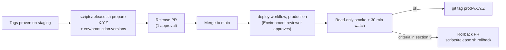

# Runbook 10: production on the same VM, release with approval, rollback, and when to split

Issue #19 (DEP-04); SRS NFR-MAI-01 (updates without downtime), NFR-AVA-01. How production (`iltiam-prod`, a second
Compose project on `iltiam-1`, [Runbook 5](05-compose-stack.md)) gets a new version, who approves it, how it goes back,
and when production must move to its own VM ([ADR-0004](../adr/0004-hosting.md)).

Written for a teammate who has never deployed: numbered steps, what to paste, what you should see, what to do when it
fails. Never paste a secret here or in any issue.

## As built

| Item | State (2026-11-23) |
|---|---|
| Production project | Not deployed yet: #36 (production environment) comes first. Staging only, for the Dec 1 demo |
| Release manifest | `releases/vX.Y.Z.md`, written by `scripts/release.sh prepare` (this runbook, section 4) |
| Approval | Two gates: the release PR needs one approving review (`main` is protected, also for admins); the deploy run waits for the `production` Environment's required reviewer ([Runbook 4](04-secrets.md), section 5.2) |
| Deploy | The `deploy` workflow with environment `production`, started by hand ([AGENTS.md](https://github.com/iltiam/iltiam-deployment/blob/main/AGENTS.md)); never automatic, never from a laptop |
| Rolling restart | AI api and worker: no downtime (`scripts/lib/rollout.sh`, iltiam-ai-service#150). Backend web, worker, beat and web: recreated in place, a few seconds without the API (section 7) |
| Read-only smoke | `scripts/smoke-readonly.sh production` |
| Rehearsal on the VM | **Not done**: needs production running (#36). Section 8 is the rehearsal script |

## 1. How a release works



- **A release** is a semver number for the set of image tags production runs: `env/production.versions` at the commit
  tagged `prod-vX.Y.Z`, described by `releases/vX.Y.Z.md`. Bump the **major** when a release needs a step by hand
  (a migration that cannot be rolled back, a new secret), the **minor** for new features, the **patch** for fixes.
- **Only tags that ran on staging** go to production. The manifest says, per image, whether staging ran the same tag.
- **Nothing is automatic.** `AUTO_DEPLOY` only ever touches staging ([Runbook 9](09-cd-staging.md)).
- **No `release.yml` or `rollback.yml`.** Issue #19 planned them as workflows. The existing `deploy` workflow already
  deploys exactly what `env/production.versions` on `main` says and waits for the production reviewer, so a release
  and a rollback are each a reviewed PR to that file (written by `scripts/release.sh`) followed by that same run. One
  workflow with secrets is less to keep safe in a public repository.

## 2. Before your first release (once)

1. #36 is done: the `production` Environment has every secret and variable, the production tunnel and buckets exist,
   and production has been deployed once (Runbook 5, section 8).
2. **Settings → Environments → production**: **Required reviewers** lists `ben-fatah` (and `Omar-Nasri` when he can
   approve). With two reviewers, turn **Prevent self-review** on (Runbook 4, section 5.2).
3. **Deployment branches**: `main` only.
4. Backups exist and a restore was tested (Runbook 5, section 12; #8). **No real patient data before that.**

## 3. Release checklist

Copy it from the manifest (`scripts/release.sh prepare` writes it there) and tick it in the PR:

- [ ] Every image's commit passed its repository's `scripts/ci-local.sh --full`.
- [ ] Every tag ran on staging for at least one day with no new error in its logs.
- [ ] `scripts/security-scan.sh images`: no CRITICAL with a fix ([scanning](../security/scanning.md)).
- [ ] Migrations: none, or listed with whether an older backend still works on the new schema (section 5).
- [ ] A production database backup taken on the day (section 4, step 2).
- [ ] Not during clinic hours (Sunday to Thursday, 08:00 to 17:00 Riyadh); a watcher named for 30 minutes after.
- [ ] Approved by someone other than the PR's author.

## 4. Release, step by step

1. **Prepare**, in your clone, on a new branch from `main`:

    ```bash
    git checkout main && git pull
    git checkout -b release/1.0.0
    # Copy what staging runs now, for the services this release changes (or all):
    scripts/release.sh promote backend
    scripts/release.sh promote web
    scripts/release.sh promote ai
    scripts/release.sh prepare 1.0.0
    ```

    `promote` reads staging's tags from `origin/auto/staging` while automatic deploys keep them there (Runbook 9),
    else from `env/staging.versions`. It never changes `COMPOSE_PROFILES`: turning a profile on in production is its
    own decision (#36). **What you should see:** `Wrote releases/v1.0.0.md`. Open it: every image says `yes` in "Same
    tag on staging". A `no` means that tag is not what staging runs: stop and check.

2. **Backup**, on the VM as `deploy`, the day of the release (until #8 makes it nightly):

    ```bash
    iltiam production exec -T postgres pg_dump -U postgres -Fc iltiam > /srv/iltiam/backups/prod-$(date +%F)-pre-1.0.0.dump
    ```

    **What you should see:** a file of a few MB or more. Write its size in the PR.

3. **PR:** commit `env/production.versions` and `releases/v1.0.0.md`, run `scripts/ci-local.sh --full`, push, open the
   PR titled `release: production v1.0.0` with the manifest's checklist and the CI table. A teammate approves; merge
   with `scripts/merge-pr.sh <PR>`.

4. **Check what will deploy**, on `main` after the merge:

    ```bash
    git checkout main && git pull
    scripts/release.sh check 1.0.0
    ```

    **What you should see:** `env/production.versions matches v1.0.0.`

5. **Deploy:** `gh workflow run deploy -R iltiam/iltiam-deployment --ref main -f environment=production`. The run waits
   with **Waiting for review**: **Review deployments → production → Approve and deploy** (the second approval). If
   GitHub also holds it ("This workflow file may be malicious"), approve that once. Watch it:
   `gh run watch <run id> -R iltiam/iltiam-deployment --exit-status`.

    **What you should see:** the run ends green; its last step lists every service `running` and `healthy` with the
    manifest's tags.

6. **Smoke**, from your laptop: `scripts/smoke-readonly.sh production`. **What you should see:**
   `Smoke: all checks passed.` Then sign in on `https://app.iltiamcare.com` with a real account and open one patient.
7. **Watch 30 minutes:** on the VM, `iltiam production logs -f --since 5m backend-web backend-worker ai-worker`, and
   `docker stats`. No 5xx, no restart, memory under the limits.
8. **Tag the release** on the merged commit:

    ```bash
    git tag -a prod-v1.0.0 -m "production v1.0.0" origin/main
    git push origin prod-v1.0.0
    ```

**If it fails:** step 5 red → read the failing step's log (names and states only); the services it did not reach still
run the old version. Fix forward with a new release, or roll back (section 5). Step 6 or 7 shows a problem → section 5.

## 5. Rollback

**Roll back at once, without discussion, when any of these happens within 24 hours of a release:**

- `scripts/smoke-readonly.sh production` fails twice, 2 minutes apart.
- 5xx answers above 1 % of requests for 5 minutes, or any 5xx on sign-in or upload.
- An analysis fails that worked on the same photo before, or `/api/ready/` names the AI service.
- A container restarts more than twice in 10 minutes.
- Patient data shown to the wrong person: also start the [incident response](../security/incident-response.md).

**Steps:**

1. On a new branch from `main`:

    ```bash
    git checkout main && git pull && git checkout -b rollback/1.0.0
    scripts/release.sh rollback            # back to the release before the newest; or: rollback 0.9.0
    ```

    **What you should see:** `env/production.versions now matches v0.9.0` and a one-file diff.
2. Commit, `scripts/ci-local.sh --full`, PR titled `rollback: production to v0.9.0`, approval, `scripts/merge-pr.sh`.
   In an emergency the approval can be a phone call: the reviewer approves in the PR right after.
3. Deploy as in section 4, step 5; smoke as in step 6.
4. **Migrations:** if the release had one, check that the older backend works on the newer schema (its release notes).
   If not, restore the backup of section 4, step 2 (Runbook 6, #8), which loses what was written since: that is the
   incident lead's decision.
5. Write in the release PR what happened; fix forward in a new patch release.

## 6. When to split production onto its own VM

Staging and production share one Always Free VM (2 OCPUs, 12 GB). Move production to its own VM, which is **paid**
(ADR-0004's cost table), when any one of these is true:

| Trigger | How to see it |
|---|---|
| Memory above 85 % for a week | `free -h` daily, or monitoring (#10): the VM's memory with both projects running |
| Production upload-to-result p95 above 4 s **because of staging load** | Production's analysis time while staging tests run (load tests, #22, `docs/perf/`; the local capped runs already show Postgres CPU is the limit) |
| A clinic contract requires its data on a server of its own | The contract (legal items, #23) |
| Object storage beyond the free 20 GB, where a second VM's storage is the cheaper half of the bill | OCI Console → Billing → Cost analysis |

Before any of these, the cheaper first steps: stop the staging AI worker when production needs the CPU (Runbook 5,
section 9.6), keep staging load tests off the VM, run staging only when needed.

**Split procedure** (a planned release, outside clinic hours):

1. In OCI, create the second VM in Riyadh (Runbook 1, the same steps), attach a new block volume, run
   `scripts/bootstrap-vm.sh`; Runbook 5, sections 4 and 5, for the `production` deploy key and `DEPLOY_HOST`.
2. Put the new VM's address and host key in the `production` Environment (`DEPLOY_HOST`, `DEPLOY_SSH_KNOWN_HOSTS`).
3. Announce a 30-minute maintenance window to the clinics.
4. On the old VM: `iltiam production stop backend-web web` (no new writes), then a `pg_dump` of both databases.
5. Copy the dumps to the new VM (`scp` over the VM-to-VM private network, never through a laptop), restore them.
6. Deploy production to the new VM (section 4, step 5) with the same release. Smoke it.
7. In Cloudflare, the `iltiam-prod` tunnel now runs from the new VM's `cloudflared` (same token): check the tunnel shows
   one healthy connector from the new VM, then `iltiam production down` on the old VM (keep its data folder 30 days).
8. Update ADR-0004 and Runbook 5's As built: staging alone on the old VM.

## 7. What "no downtime" means today

- **AI api and AI worker** roll: the new container starts next to the old one and the old one stops only when the new
  one has loaded its model ([Runbook 5](05-compose-stack.md), section 1). Analyses in progress finish (60 s grace).
- **Backend web** is recreated: Compose stops the old container (30 s for requests in progress) and starts the new
  one, so for about 5 to 20 seconds the API answers 502 through the tunnel. The apps retry, and an upload keeps its
  Idempotency-Key, so a retry never makes a second visit.
- **Backend worker and beat**: stopped with a 60 s grace, so a task in progress finishes; queued tasks wait in Redis.
- **Web**: nginx is recreated in about a second.

To reach zero failed requests for the API too (the issue's acceptance), the backend web needs the same rollout as the
AI service: `scripts/lib/rollout.sh` with the backend's `/api/ready/` as its ready command. That change touches
`scripts/deploy.sh`, which the automatic staging deploy also runs, so it waits until after the Dec 1 demo freeze
(Runbook 9, section 3), then goes through staging first.

## 8. Rehearsal (to do on the VM once #36 is done)

Record the results in issue #19.

1. Prepare v0.9.0 with production's current tags (section 4, steps 1 to 4) and deploy it: the baseline.
2. In another terminal, the request loop (read-only, 2 requests a second, from your laptop):

    ```bash
    for i in $(seq 1 600); do curl -s -o /dev/null -w '%{http_code}\n' https://api.iltiamcare.com/api/health/; sleep 0.5; done | sort | uniq -c
    ```

3. While it runs: release v0.9.1 with one changed tag (an AI tag first, then a backend tag in a second rehearsal).
4. When the loop ends, the counts show every non-200 answer. AI-only release: expect `600 200`. Backend release: expect
   a few 502 (section 7) until the backend rollout exists.
5. Roll back to v0.9.0 (section 5) with the loop running again; same counts expected.
6. Write in #19: date, tags, counts of each run, how long each deploy took.

## 9. Troubleshooting

| What you see | Fix |
|---|---|
| `release.sh: vX.Y.Z is not newer than the last release` | Pick the next number; numbers are never reused |
| `does not pass scripts/deploy.sh --check-versions` | A `to-confirm` tag for a profile that is on, or a malformed line: fix `env/production.versions` |
| `release.sh check` shows DIFF | Someone changed `env/production.versions` after the manifest: prepare a new release |
| The deploy run waits forever | Nobody approved: **Review deployments**, or the GitHub hold ("This workflow file may be malicious") |
| The rollout stops with "not enough free memory" | Stop the staging AI worker (Runbook 5, section 9.6) and run the deploy again |
| Smoke: API docs answer 200 in production | `API_DOCS_ENABLED` is set in the production Environment: remove it; production never serves them |
